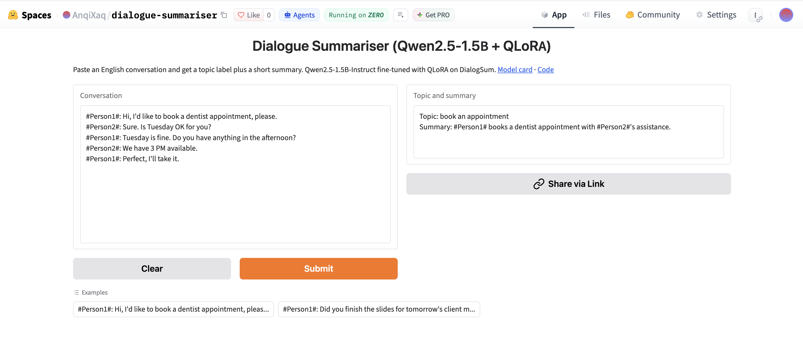
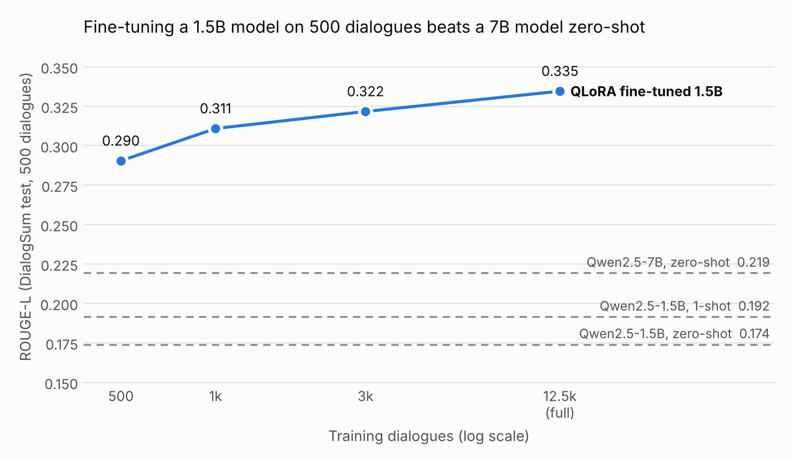

<h1 align="center">DialogSum QLoRA</h1>

<p align="center"><em>Dialogue summarisation with a 1.5B model, fine-tuned on a single free T4.</em></p>

<p align="center">
  <a href="https://huggingface.co/spaces/AnqiXaq/dialogue-summariser"></a>
  <a href="https://huggingface.co/AnqiXaq/dialogsum-qlora-adapter"></a>
  
  
  <a href="LICENSE"></a>
</p>

Fine-tunes **Qwen2.5-1.5B-Instruct** with **QLoRA** to turn a conversation into a short structured record:

```
Topic: ask for help
Summary: Tom calls Sara because his daughter has a high fever. Sara agrees to look after his son.
```

The point is less the final number than doing fine-tuning properly: a fair baseline, ablations that isolate each change, significance tests, and an error analysis.



## Highlights

- **Fine-tuning beats scale.** 500 training dialogues lift ROUGE-L from 0.174 to 0.290, past Qwen2.5-7B zero-shot (0.219; better on 78% of test dialogues, p < 0.001).
- **Data drives the gain.** Every step up the data curve is significant, with diminishing returns; the full 12,460 dialogues reach 0.335.
- **Loss masking is a small effect.** Summary-only loss adds +0.5 ROUGE-L, not significant.
- **ROUGE misses real errors.** A manual pass finds speaker confusion and unsupported details that the metric barely penalises.

## Results

| Model | Train | ROUGE‑1 | ROUGE‑2 | ROUGE‑L | BERTScore | Words |
|---|---:|---:|---:|---:|---:|---:|
| Qwen2.5‑1.5B, zero‑shot | 0 | 0.227 | 0.062 | 0.174 | 0.879 | 41.0 |
| Qwen2.5‑1.5B, 1‑shot | 0 | 0.241 | 0.075 | 0.192 | 0.884 | 33.7 |
| Qwen2.5‑7B, zero‑shot | 0 | 0.288 | 0.085 | 0.219 | 0.879 | 39.6 |
| QLoRA 1.5B | 500 | 0.361 | 0.128 | 0.290 | 0.907 | 25.6 |
| QLoRA 1.5B | 1,000 | 0.385 | 0.139 | 0.311 | 0.911 | 22.2 |
| QLoRA 1.5B | 3,000 | 0.399 | 0.149 | 0.322 | 0.914 | 23.3 |
| **QLoRA 1.5B (v2)** | **12,460** | **0.414** | **0.157** | **0.335** | **0.917** | **21.9** |

DialogSum test set (500 dialogues, 3 references each); greedy decoding, same prompt for every model. Raw predictions are in [`results/`](results).

<details>
<summary>ROUGE-L vs. training data</summary>



</details>

### Where the v1 → v2 gain came from

| Change | ROUGE‑L | Δ | 95% CI | p |
|---|---:|---:|---|---:|
| v1 | 0.313 | | | |
| + training setup (shuffled subset, cosine LR, fp16, best checkpoint) | 0.317 | +0.3 | [-0.4, +1.0] | 0.36 |
| + loss on the summary only | 0.322 | +0.5 | [-0.2, +1.2] | 0.13 |
| + all 12,460 dialogues (v2) | 0.335 | +1.3 | [+0.5, +2.1] | 0.001 |

95% CIs and p-values from a paired bootstrap over the 500 test dialogues ([`analysis/significance.py`](analysis/significance.py)).

## Error analysis

50 random test dialogues, read next to v2's summaries ([annotations](analysis/error_annotations.csv)):

| Outcome | Count |
|---|---:|
| Faithful and covers the main point | 36 (72%) |
| Unsupported detail or wrong causal link | 8 (16%) |
| Speaker confusion (who did what) | 5 (10%) |
| Faithful details, misses the point | 1 (2%) |

Typical speaker confusion: in a call where Andy asks for Naomi and her sister Nancy answers, v2 writes *"Nancy calls Tyler's house to leave a message"*.

<details>
<summary>Training setup and engineering notes</summary>

| Setting | Value |
|---|---|
| Base model | Qwen/Qwen2.5‑1.5B‑Instruct, 4-bit NF4, double quantisation |
| LoRA | r = 16, α = 32, dropout 0.05, all attention and MLP projections (18.5M trainable parameters) |
| Training | 1 epoch, LR 2e-4 cosine, 20 warm-up steps, batch 4 × 2 accumulation, max length 1024, seed 42 |
| Hardware | 1 × NVIDIA T4 (Kaggle) |

- **T4 precision.** The T4 only emulates bf16. fp16 with fp32 LoRA master weights made each step about 5× faster (3.4 s vs 16.1 s); the full epoch takes 85 minutes.
- **Validation.** Loss on 200 dialogues every 200 steps, best checkpoint kept; v2 fell from 0.884 to 0.811 with no sign of overfitting.
- **Significance.** 10,000 bootstrap resamples over dialogues, not rows: each dialogue appears three times in the test file (once per reference), and treating those copies as independent would make intervals too narrow.

</details>

## Reproduce

```bash
pip install -r requirements.txt
python train.py --out-dir runs/v2                      # see python train.py --help
python run_eval.py --name v2 --adapter runs/v2/adapter
python compare.py                                      # table of everything in results/
python analysis/significance.py results v2 v1          # paired bootstrap
```

[EXPERIMENTS.md](EXPERIMENTS.md) has the exact Kaggle command for every run.

## Repository

| Path | Purpose |
|---|---|
| `train.py` | QLoRA fine-tuning (data size, loss type, LoRA rank, precision as flags) |
| `run_eval.py` | ROUGE + BERTScore on the test split, saves every prediction |
| `compare.py` | Table of all eval runs |
| `data.py` · `inference.py` | Prompt format; summarise one conversation |
| `push_to_hub.py` | Tag and upload adapter versions to the Hub |
| `analysis/` | Significance test, scaling plot, error annotations |
| `results/` | Predictions, metrics and training logs for every run |
| `space/` | Gradio demo for the Hugging Face Space |
| `hub/README.md` | Model card |

## Limitations

- English, everyday two-person conversations only.
- ROUGE barely notices speaker and factual errors; the error analysis is single-annotator.
- One seed per configuration; read sub-point differences with their confidence intervals.

## License

Code: [Apache 2.0](LICENSE). The adapter is trained on DialogSum (CC BY-NC-SA 4.0) and is for non-commercial use only.
